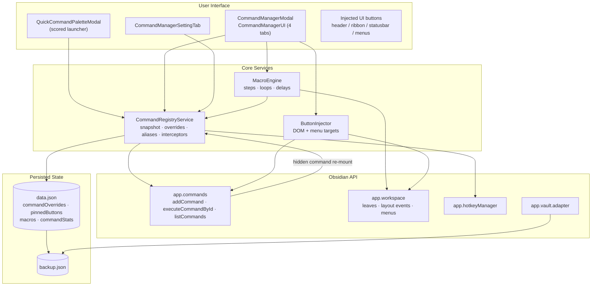
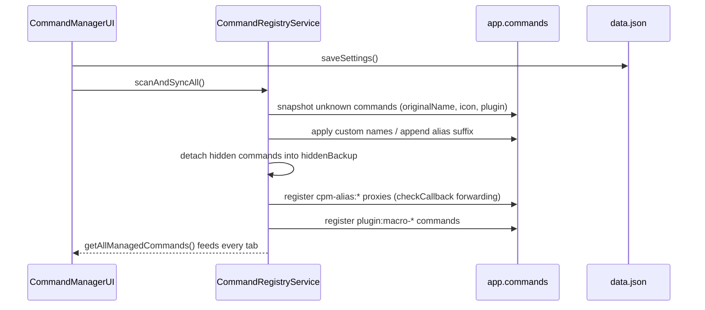
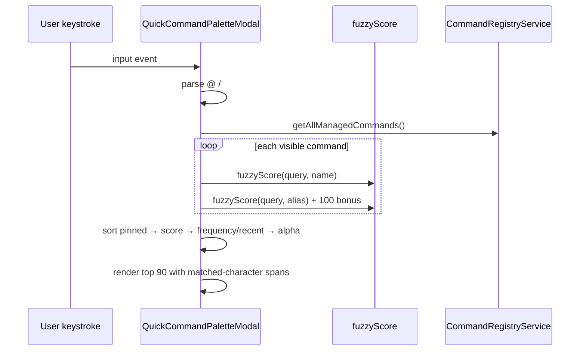
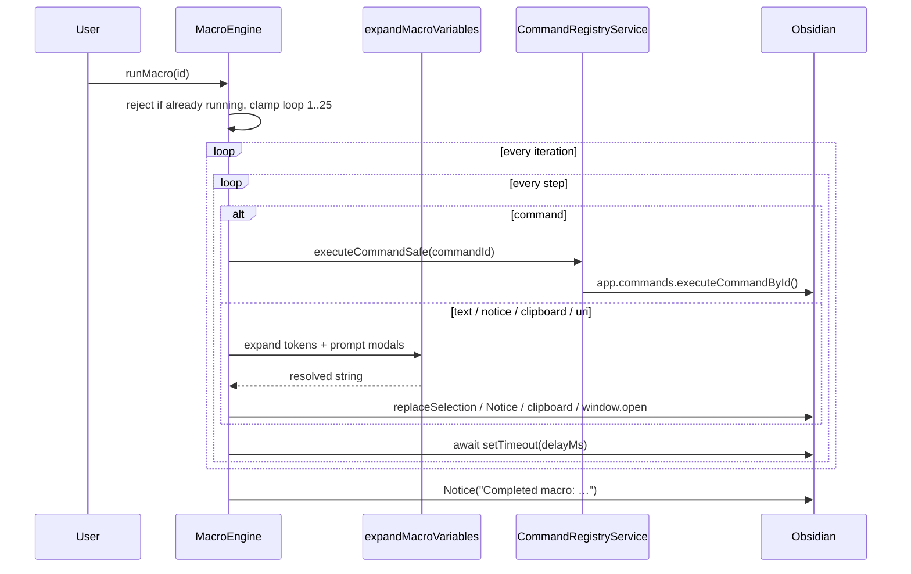
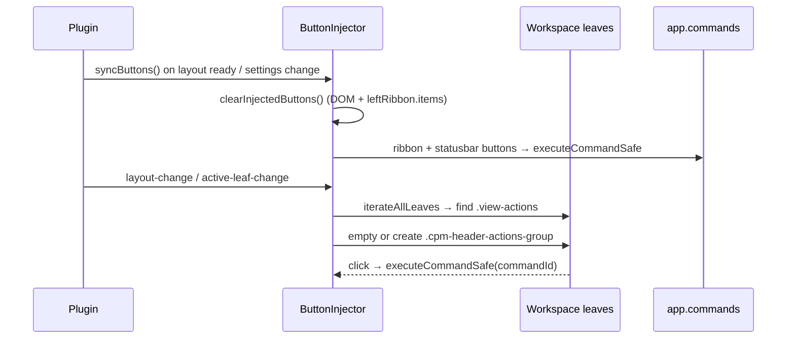
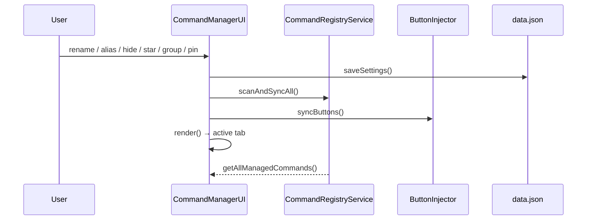

# System Architecture (`ARCHITECTURE.md`)
> **1-Line Summary:** Plain-English map of how the plugin's UI, services, and Obsidian APIs fit together, plus the checks and recipes needed to change it safely.

## 1. High-Level Visual System Map

## 2. Tech Stack & Why We Chose It

| Layer | Tool / Library | Plain-English Reason Why |
| --- | --- | --- |
| Host | Obsidian plugin API | The app is a plugin, so every feature lives inside the user's existing vault and workspace. |
| Language | TypeScript 5 (strict, `noUncheckedIndexedAccess`) | Command tables and settings are loose JSON; strict types catch shape mistakes during porting. |
| Bundler | esbuild (CommonJS output) | Obsidian loads a single `main.js`; esbuild produces it fast and keeps the build a one-liner. |
| UI | Plain DOM via Obsidian's `createEl` / `setIcon` | No framework dependency keeps startup light and matches the host's native styling. |
| Matching | Hand-written scorer in `src/fuzzy.ts` | Owns the ranking rules (exact, prefix, word, acronym, subsequence) with zero dependencies. |
| Persistence | `loadData` / `saveData` plus `backup.json` | Native settings storage with a user-restorable snapshot written through the vault adapter. |

## 3. Core Subsystems & Engineering Tricks

### [SUBSYSTEM: Command-Registry-And-Overrides] | Aliases: registry, rename, hide, alias proxy, interceptors

> **1-Line Summary:** Keeps an immutable snapshot of every command, then applies renames, hides, and alias proxies while protecting native hotkey execution.

* **How It Works (Plain English):** On layout ready the registry walks `app.commands.commands` once and stores each command's original name, icon, and source plugin. It then installs three wrappers (`executeCommandById`, `findCommand`, `listCommands`). Hidden commands are moved into a backup map and re-mounted only for the duration of an execution, so hotkeys keep working while palettes stop listing them. Renames are written directly onto the live command object; aliases become separate `cpm-alias:*` commands whose `checkCallback` forwards to the real command.
* **Data Flow Diagram:**

* **Code Anchors (Grep Targets):**
  * `src/registry.ts` -> `CommandRegistryService.scanAndSyncAll`, `installCommandInterceptors`, `syncOverrides`, `syncAliases`, `syncMacros`
  * `src/registry.ts` -> `CommandRegistryService.getAllManagedCommands`, `executeCommandSafe`, `revertCommand`

### [SUBSYSTEM: Scored-Fuzzy-Launcher] | Aliases: quick palette, fuzzy scoring, match highlight, prefix operators

> **1-Line Summary:** Scores commands against the query with five ranked strategies and renders highlighted matches with full keyboard control.

* **How It Works (Plain English):** `fuzzyScore` returns a numeric score plus the character indices that matched. The palette keeps the best score per command (name, alias with a bonus, plugin name at a discount), sorts pinned first, then by score, then by the user's chosen secondary sort, and renders the top 90 rows. Prefix characters change the filter instead of the query: `@` group, `#` plugin, `!` macro, `*` pinned.
* **Data Flow Diagram:**

* **Code Anchors (Grep Targets):**
  * `src/quick-palette.ts` -> `QuickCommandPaletteModal.renderResults`, `updateHighlight`
  * `src/fuzzy.ts` -> `fuzzyScore`, `renderHighlightedText`, `debounce`

### [SUBSYSTEM: Macro-Execution-Pipeline] | Aliases: macro, steps, variables, prompt, clipboard, uri

> **1-Line Summary:** Runs macro steps in order, expands template variables per step, and awaits delays so Obsidian never blocks.

* **How It Works (Plain English):** A macro is an ordered list of typed steps with an optional per-step delay and a loop count clamped to 1–25. Command steps call back into the registry (so hidden commands still run). Text-bearing steps pass through `expandMacroVariables`, which fills date/time tokens, active note metadata, selection, clipboard, a generated UUID, and blocks on a modal for every `{{prompt:Label}}`. URIs are validated against an allowlist before `window.open`.
* **Data Flow Diagram:**

* **Code Anchors (Grep Targets):**
  * `src/macro-engine.ts` -> `MacroEngine.runMacro`, `MacroEngine.runningMacros`
  * `src/macro-variables.ts` -> `expandMacroVariables`
  * `src/fuzzy.ts` -> `validateSafeUri`

### [SUBSYSTEM: UI-Button-Injection] | Aliases: header buttons, ribbon, status bar, context menu, pin

> **1-Line Summary:** Renders pinned commands into five surfaces and reconciles them without duplicating DOM nodes.

* **How It Works (Plain English):** Ribbon and status-bar buttons are created through the plugin API and tracked so they can be removed. Header buttons are written into one `.cpm-header-actions-group` container per leaf, which is emptied and rebuilt when the layout changes — never by prepending individual buttons, which used to invert their order. Context menus add a separator plus one item per matching pin.
* **Data Flow Diagram:**

* **Code Anchors (Grep Targets):**
  * `src/buttons.ts` -> `ButtonInjector.syncButtons`, `injectHeaderButtons`, `populateContextMenu`, `clearInjectedButtons`
  * `src/modals.ts` -> `VisualIconPickerModal`

### [SUBSYSTEM: Management-UI-State] | Aliases: tabs, bulk bar, grouping, selection, infinite scroll, card style

> **1-Line Summary:** One controller renders four tabs, filters, multi-select, grouped sections, and chunked scrolling over the same managed-command list.

* **How It Works (Plain English):** `CommandManagerUI` holds all transient view state (active tab, search text, plugin/group/status filters, selected IDs, collapsed sections, render limit). Every mutation saves settings, re-runs the registry sync, refreshes injected buttons, then re-renders the current tab. Selection supports shift-range with an expanded render limit so the viewport never collapses under the user's cursor.
* **Data Flow Diagram:**

* **Code Anchors (Grep Targets):**
  * `src/command-manager-ui.ts` -> `CommandManagerUI.render`, `renderCommandsTab`, `renderListRows`, `buildCommandItem`, `renderGroupsTab`, `renderButtonsTab`, `renderMacrosTab`
  * `src/command-manager-ui.ts` -> `CommandManagerUI.saveAndApply`, `runDestructive`

## 4. Verification & Health Checks

### [VERIFY: Build-Typecheck-And-Lint] | Aliases: test command, build check, proof nothing broke, CI

> **1-Line Summary:** The exact commands an AI or human must run before claiming a change is complete.

* **Type Check:** `npx tsc -noEmit -skipLibCheck`
* **Lint:** `npm run lint`
* **Production Bundle:** `npm run build` (runs the type check, then esbuild → `main.js`)
* **Manual Smoke Test:** copy `main.js`, `manifest.json`, `styles.css` into `<Vault>/.obsidian/plugins/command-palette-manager/`, reload, then open both modals and toggle one rename, one alias, one hide, and one macro.

## 5. Recipes: How to Add New Things Safely

* **To add a new macro step type:**
  1. Extend `MacroStepType` in `src/types.ts` -> `MacroStepType`.
  2. Handle it inside `src/macro-engine.ts` -> `MacroEngine.runMacro`.
  3. Add the option to the step selector in `src/command-manager-ui.ts` -> `renderMacrosTab`.
  4. Add its display label in the same function's `typeLabel` chain.

* **To add a new pin location (for example a footer bar):**
  1. Extend `PinnedButton.location` in `src/types.ts`.
  2. Handle it inside `src/buttons.ts` -> `ButtonInjector.syncButtons` or `injectHeaderButtons`.
  3. Register the refresh listener in `src/main.ts` -> `onload` if the surface is recreated by the workspace.
  4. Add the option to both location selectors in `src/command-manager-ui.ts` -> `renderButtonsTab`.

* **To add a new quick-palette filter operator:**
  1. Parse the prefix in `src/quick-palette.ts` -> `QuickCommandPaletteModal.renderResults`.
  2. Apply the filter before scoring so hidden and out-of-scope commands never consume the result budget.
  3. Mention it in the input placeholder and footer hints.

* **To add a new intake from another plugin's settings:**
  1. Read the foreign settings defensively in `src/registry.ts` -> `CommandRegistryService.importExternalConfigs`.
  2. Only add entries that do not already exist, and increment `importedCount`.
  3. Call `scanAndSyncAll()` and `buttonInjector.syncButtons()` once at the end.
