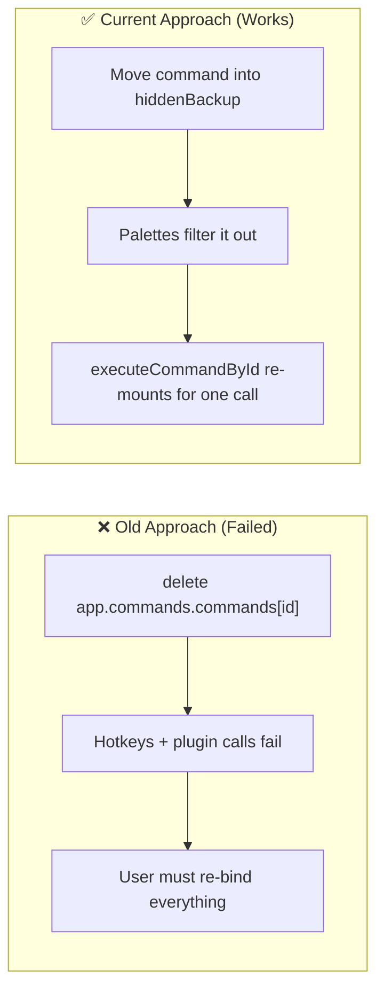
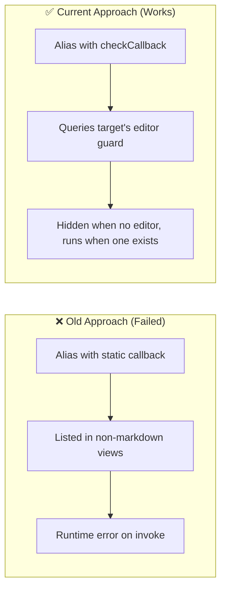
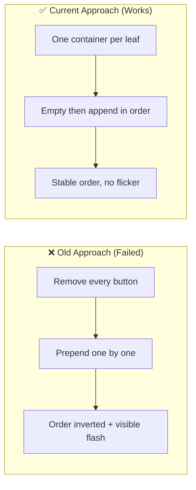
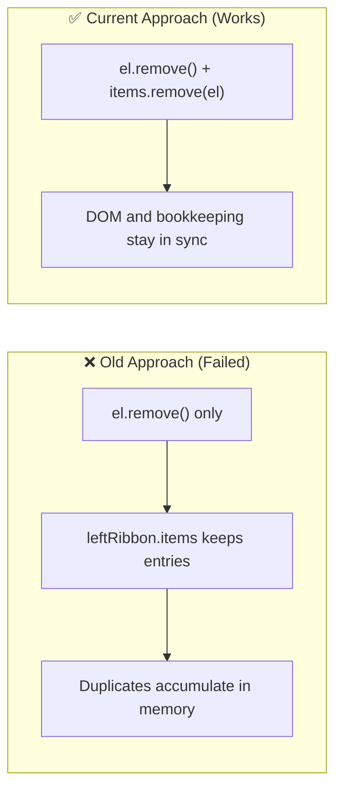
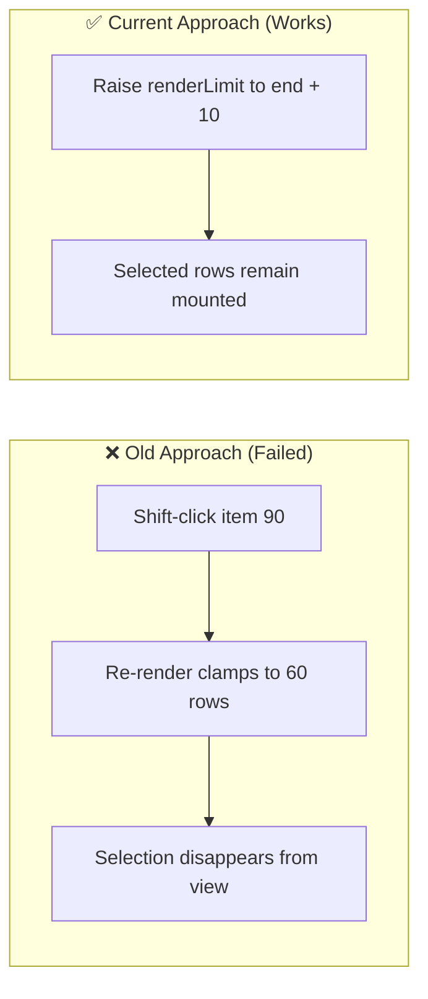
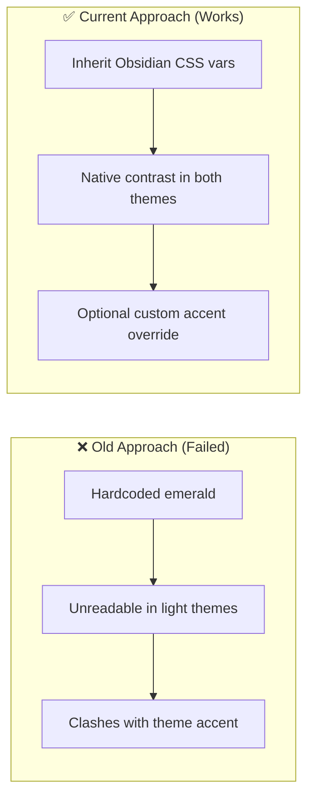
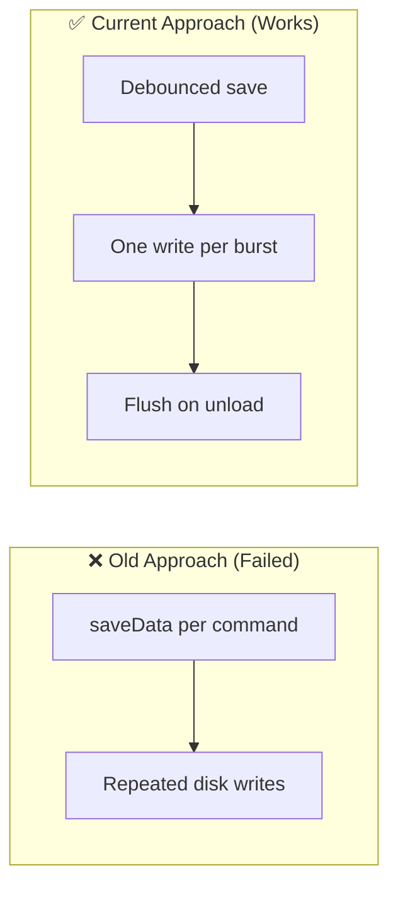

# Architectural Decisions, Pivots & Landmines (`DECISIONS_AND_TRAPS.md`)
> **1-Line Summary:** Why each non-obvious mechanism exists, which broken approach it replaced, who decided it, and what must never be changed.

## 1. Architectural Decisions & Pivot History

### [DECISION: Interceptors-Over-Command-Deletion] | Aliases: hidden commands, broken hotkeys, listCommands, executeCommandById
> **1-Line Summary:** Hiding a command moves it to a backup map instead of deleting it, with wrappers keeping hotkeys and API calls alive.
* **Decision Maker:** `[DECIDED BY: HUMAN]` (v1.1.0 fix documented in the live architecture notes)
* **Original User Intention:** Declutter the palette without losing the ability to trigger a hidden command from its hotkey or another plugin.
* **Options Considered:**
  * **Option A (Rejected):** `delete app.commands.commands[id]` — the hotkey manager reads from that table, so every bound shortcut failed immediately.
  * **Option B (Chosen):** `hiddenBackup` map plus interceptors on `executeCommandById` and `findCommand`, and filtering in `listCommands`.
* **Visual Pivot Map (What Failed vs. What Works):**

* **Code Anchors (Grep Targets):**
  * `src/registry.ts` -> `CommandRegistryService.installCommandInterceptors`, `hiddenBackup`, `syncOverrides`

### [DECISION: Context-Aware-Alias-Proxies] | Aliases: checkCallback, editorCallback, palette pollution, alias command
> **1-Line Summary:** Alias commands forward `checkCallback`/`editorCheckCallback` instead of using a plain callback, so editor commands hide themselves outside markdown views.
* **Decision Maker:** `[DECIDED BY: HUMAN]` (v1.1.0 fix)
* **Original User Intention:** Aliases for Bold, Italic, or Table should not offer themselves while a PDF, Canvas, or Graph view is focused.
* **Options Considered:**
  * **Option A (Rejected):** Static `callback()` — the alias was always listed and threw when the target required an editor.
  * **Option B (Chosen):** `checkCallback(checking)` that inspects the target's own guard and returns `false` when no editor exists.
* **Visual Pivot Map (What Failed vs. What Works):**

* **Code Anchors (Grep Targets):**
  * `src/registry.ts` -> `CommandRegistryService.registerAliasProxyCommand`

### [DECISION: Single-Header-Actions-Container] | Aliases: header button order, duplicate buttons, view-actions, DOM churn
> **1-Line Summary:** Header buttons live in one reconciled container per leaf, which fixes inverted order and flashing on tab changes.
* **Decision Maker:** `[DECIDED BY: HUMAN]` (v1.1.0 fix)
* **Original User Intention:** Pinned header buttons should appear in the order the user configured, without flicker when switching notes.
* **Options Considered:**
  * **Option A (Rejected):** `querySelectorAll(".cpm-header-btn").remove()` then prepend each button — inverted the order and flashed on every `layout-change`.
  * **Option B (Chosen):** One `.cpm-header-actions-group` prepended once, emptied and refilled on refresh.
* **Visual Pivot Map (What Failed vs. What Works):**

* **Code Anchors (Grep Targets):**
  * `src/buttons.ts` -> `ButtonInjector.injectHeaderButtons`

### [DECISION: Ribbon-Item-Deregistration] | Aliases: duplicate ribbon icons, leftRibbon items, memory leak
> **1-Line Summary:** Removing a ribbon element also removes it from the workspace's internal ribbon item list.
* **Decision Maker:** `[DECIDED BY: HUMAN]` (v1.1.0 fix)
* **Original User Intention:** Repeated settings saves must not accumulate invisible ribbon entries.
* **Options Considered:**
  * **Option A (Rejected):** `el.remove()` alone — the DOM node vanished but `app.workspace.leftRibbon.items` kept stale references.
  * **Option B (Chosen):** Also call `leftRibbon.items.remove(el)` for each injected icon.
* **Visual Pivot Map (What Failed vs. What Works):**

* **Code Anchors (Grep Targets):**
  * `src/buttons.ts` -> `ButtonInjector.clearInjectedButtons`

### [DECISION: Expand-Render-Limit-On-Range-Select] | Aliases: shift click, viewport collapse, renderLimit, bulk selection
> **1-Line Summary:** Shift-range selection raises the render limit past the last selected item so the viewport never collapses.
* **Decision Maker:** `[DECIDED BY: HUMAN]` (v1.1.0 fix)
* **Original User Intention:** Selecting a long range past item 60 must keep those items visible.
* **Options Considered:**
  * **Option A (Rejected):** Re-render clamped at 60 rows — items 61+ disappeared while scroll stayed down.
  * **Option B (Chosen):** `renderLimit = Math.max(renderLimit, end + 10)` before re-rendering.
* **Visual Pivot Map (What Failed vs. What Works):**

* **Code Anchors (Grep Targets):**
  * `src/command-manager-ui.ts` -> `CommandManagerUI.buildCommandItem` (checkbox handler)
  * `src/command-manager-ui.ts` -> `CommandManagerUI.renderLimit`

### [DECISION: Theme-Variable-Inheritance] | Aliases: accent color, light theme clash, hardcoded green, WCAG
> **1-Line Summary:** Colors come from Obsidian CSS variables with an optional custom accent, replacing a hardcoded emerald palette.
* **Decision Maker:** `[DECIDED BY: HUMAN]` (v1.1.0 fix)
* **Original User Intention:** The plugin must look native in light themes and in community themes with purple, blue, or red accents.
* **Options Considered:**
  * **Option A (Rejected):** Hardcoded `#00a884` everywhere — broke contrast in light themes and clashed with themed accents.
  * **Option B (Chosen):** Inherit `--interactive-accent`, `--text-normal`, `--background-modifier-border`; expose a custom accent that writes `--cpm-accent`.
* **Visual Pivot Map (What Failed vs. What Works):**

* **Code Anchors (Grep Targets):**
  * `src/command-manager-ui.ts` -> `CommandManagerUI.render`
  * `styles.css` -> `.cpm-root`, `.cpm-glassmorphic`

### [DECISION: Debounced-Usage-Persistence] | Aliases: disk thrashing, saveData, commandStats, debounce
> **1-Line Summary:** Usage statistics are written 1.2 seconds after the last execution instead of on every command.
* **Decision Maker:** `[DECIDED BY: AGENT — Approved by Human]`
* **Original User Intention:** Track frequency ranking without turning fast command usage into a disk-write storm.
* **Options Considered:**
  * **Option A (Rejected):** `saveData` inside every execution — each keystroke-driven command triggered a write.
  * **Option B (Chosen):** `debounce(…, 1200)` plus a final flush on unload.
* **Visual Pivot Map (What Failed vs. What Works):**

* **Code Anchors (Grep Targets):**
  * `src/registry.ts` -> `CommandRegistryService.recordCommandUsage`, `debouncedSaveUsageStats`
  * `src/registry.ts` -> `CommandRegistryService.restoreAllOnUnload`

---

## 2. Do-Not-Touch Engineering Landmines (Traps)

### [TRAP: Never-Permanently-Delete-Commands] | Aliases: delete command, hidden hotkey broken, command table
> **1-Line Summary:** **NEVER** remove a command from `app.commands.commands` permanently; stash it in `hiddenBackup` instead.
* **Strict Rule:** **NEVER** replace the backup-map hide with `delete` or with `removeCommand`, and never remove the interceptors.
* **Why This Trap Exists (Plain English):** Obsidian's hotkey manager and other plugins read the same command table. A deleted entry makes every bound shortcut and every integration call fail silently until the plugin is re-enabled.
* **Protected Code Anchors (Grep Targets):**
  * `src/registry.ts` -> `CommandRegistryService.installCommandInterceptors`, `CommandRegistryService.syncOverrides`, `CommandRegistryService.executeCommandSafe`

### [TRAP: Header-DOM-Recreated-On-Leaf-Focus] | Aliases: duplicate header buttons, order inverted, view-actions
> **1-Line Summary:** **NEVER** prepend individual header buttons; rebuild the single `.cpm-header-actions-group` container instead.
* **Strict Rule:** **NEVER** inject `.cpm-header-btn` directly into `.view-actions`.
* **Why This Trap Exists (Plain English):** Obsidian recreates leaf chrome when focus moves. Per-button injection both duplicates entries and reverses their order, and the bug looks like a styling glitch rather than a logic error.
* **Protected Code Anchors (Grep Targets):**
  * `src/buttons.ts` -> `ButtonInjector.injectHeaderButtons`, `ButtonInjector.clearInjectedButtons`

### [TRAP: Macro-Delay-Busy-Wait] | Aliases: frozen window, setTimeout, blocking loop, delay step
> **1-Line Summary:** **NEVER** implement a macro delay with a synchronous wait loop; it freezes the Electron renderer.
* **Strict Rule:** **NEVER** use `while (Date.now() < end) {}` or any synchronous sleep inside `MacroEngine.runMacro`.
* **Why This Trap Exists (Plain English):** Obsidian runs on a single renderer thread. A busy-wait blocks painting and input, so the UI appears hung and Obsidian may flag the plugin as unresponsive.
* **Protected Code Anchors (Grep Targets):**
  * `src/macro-engine.ts` -> `MacroEngine.runMacro` (delay handling)

### [TRAP: Alias-Slug-Collisions] | Aliases: duplicate alias, silent overwrite, slug, proxy id
> **1-Line Summary:** Two aliases that differ only by punctuation produce the same proxy command ID, so only the last one is registered.
* **Strict Rule:** **NEVER** change the proxy ID scheme to include arbitrary punctuation without also handling collisions; the ID must stay filesystem/command-safe.
* **Why This Trap Exists (Plain English):** Proxy IDs are built as `cpm-alias:<target>:<slug>` where the slug strips everything except `a-z 0-9 _ -`. Aliases like `my:alias` and `my-alias` therefore collapse into one command, and Obsidian keeps a single entry. The user sees a missing alias with no error.
* **Protected Code Anchors (Grep Targets):**
  * `src/registry.ts` -> `CommandRegistryService.syncAliases`

### [TRAP: Live-Vault-Is-Read-Only] | Aliases: Nihon vault, do not edit, production vault, ground truth
> **1-Line Summary:** **NEVER** write to `Nihon/.obsidian/plugins/**`; it is the production ground truth used for reverse engineering.
* **Strict Rule:** **NEVER** edit, move, rename, or delete anything under `C:\Users\kazir\Documents\Obsidian Vaults\Nihon\`.
* **Why This Trap Exists (Plain English):** The live bundle is the only authoritative reference for behavior that has not yet been ported. Mutating it destroys the reference and can break the user's daily workflow.
* **Protected Code Anchors (Grep Targets):**
  * `runtime/main.js` (frozen plug-and-play copy) and the read-only vault files it mirrors

### [TRAP: Settings-Key-Compatibility] | Aliases: data.json, lost settings, defaults, migration
> **1-Line Summary:** **NEVER** rename or restructure a key in `DEFAULT_SETTINGS` without a migration; existing `data.json` values would be dropped.
* **Strict Rule:** **NEVER** change the shape of `commandOverrides`, `pinnedButtons`, `macros`, or `commandStats` without reading the old shape first.
* **Why This Trap Exists (Plain English):** Settings load through `Object.assign({}, DEFAULT_SETTINGS, loaded)`. A renamed key silently falls back to its default, wiping the user's aliases or pins with no warning.
* **Protected Code Anchors (Grep Targets):**
  * `src/settings.ts` -> `DEFAULT_SETTINGS`
  * `src/main.ts` -> `CommandPaletteManagerPlugin.loadSettings`
