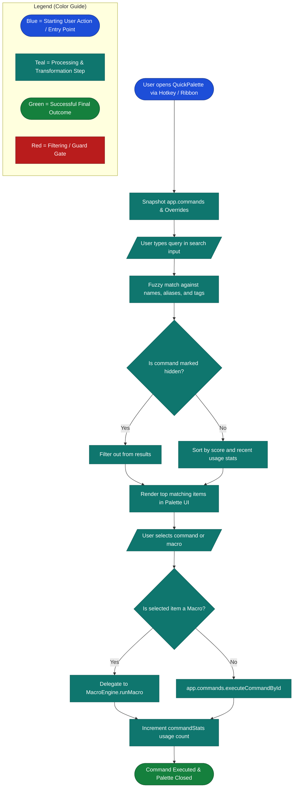
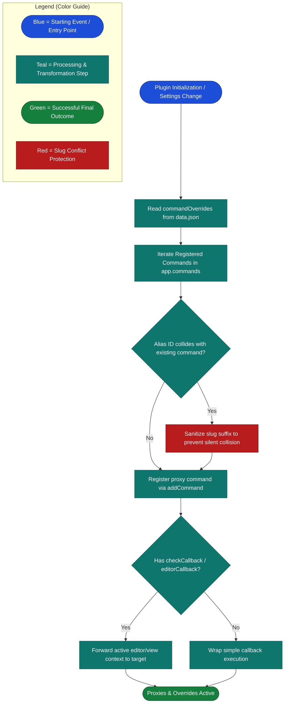

# Visual Feature & Change Log (`VISUAL_LOG.md`)
> **1-Line Summary:** Plain-English, color-coded Obsidian-compatible Mermaid flowcharts explaining how each major flow in Command Palette Manager operates end to end.

## Feature & Change Flowcharts

### [VISUAL: Raycast-Palette-Launcher-Flow] | Aliases: quick launcher, fuzzy search, raycast palette
> **1-Line Summary:** How the Raycast-style launcher searches, ranks, and triggers commands, aliases, macros, and assigned hotkeys.

* **Plain-English Walkthrough:** When the user presses the launcher hotkey, `QuickPalette` displays an overlay search prompt. As characters are typed, the input is scored using fuzzy matching against registered commands, custom aliases, and macros. Hidden commands are filtered out unless explicitly requested. Selecting a result directly executes the target or steps through a macro sequence while recording execution counts.

* **Code Anchors (Grep Targets):**
  * `src/quick-palette.ts` -> `QuickPalette.open`, `getItems`, `onChooseItem`
  * `src/fuzzy.ts` -> `fuzzyScore`, `highlightMatches`
  * `src/registry.ts` -> `recordCommandUsage`

---

### [VISUAL: Alias-And-Override-Interceptor-Flow] | Aliases: command interceptor, custom alias, proxy registration
> **1-Line Summary:** How user overrides and aliases wrap native commands dynamically without deleting host command structures.

* **Plain-English Walkthrough:** Instead of mutating Obsidian's core command definitions (which could break hotkeys and cause exceptions), the plugin uses non-destructive alias proxies and wrapper interceptors. Renamed labels, custom icons, and proxy slugs are registered dynamically on startup and hot-reloaded cleanly upon settings changes.

* **Code Anchors (Grep Targets):**
  * `src/registry.ts` -> `registerAliasProxies`, `applyOverride`
  * `src/main.ts` -> `onload`, `saveSettings`
